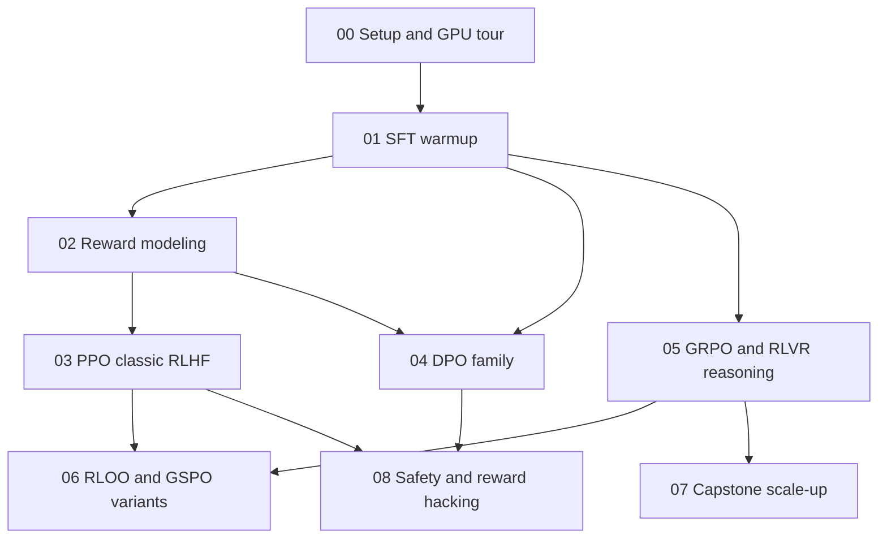

# LLM RL Alignment Labs

A hands-on curriculum for learning how LLM post-training alignment via reinforcement
learning actually works -- from the raw math (a few hundred lines of PyTorch) up to
production-scale training with [TRL](https://github.com/huggingface/trl) + vLLM on an
8x NVIDIA B200 node.

## How this curriculum is built

Every lab that involves an RL/alignment algorithm has two implementations:

1. **`scratch/`** -- the algorithm hand-written in plain PyTorch (rollout collection,
   advantage estimation, the PPO/GRPO/DPO loss, the reward-model loss) on GPT-2 (124M).
   No RL library involved. This is where you build intuition for what's actually
   happening to the gradients. Each file is a single, heavily-commented script meant to
   be read top-to-bottom, ~200-350 lines.
2. **`trl/`** -- the same idea, redone with Hugging Face's `trl` trainers on a real
   instruction model (Qwen2.5-0.5B/1.5B/Math-1.5B), with vLLM accelerating generation.
   This is what you'd actually reach for in practice, and it's where the B200s get
   exercised.

Nothing here is a fill-in-the-blank exercise -- every script runs as-is. Each lab's
`README.md` has the theory/derivation plus a "things to try" section (change β, break
the reward on purpose, sweep a hyperparameter) since the fastest way to understand an RL
algorithm is to perturb it and watch what happens.

## Curriculum map



| # | Lab | What you'll learn | GPUs needed |
|---|-----|--------------------|--------------|
| [00](labs/00_setup_and_gpu_tour/) | Setup and GPU tour | Verify the stack (torch/CUDA/vLLM), NCCL sanity check, throughput baseline | 1 (then all 8 briefly) |
| [01](labs/01_sft_warmup/) | SFT warmup | Why RLHF starts from a supervised policy; loss masking, the training loop everything else builds on | 1 |
| [02](labs/02_reward_modeling/) | Reward modeling | Bradley-Terry preference model, the reward model PPO optimizes against | 1 |
| [03](labs/03_ppo_rlhf/) | PPO / classic RLHF | Rollouts, GAE, clipped surrogate loss, KL-to-reference penalty (InstructGPT recipe) | 1 |
| [04](labs/04_dpo_family/) | DPO family | Deriving DPO from the Bradley-Terry model; DPO vs KTO vs PPO trade-offs | 1 |
| [05](labs/05_grpo_rlvr_reasoning/) | GRPO and RLVR reasoning | Critic-free policy gradients, group-normalized advantage, verifiable rewards (DeepSeek-R1-style) | 1 |
| [06](labs/06_rloo_and_gspo/) | RLOO and GSPO variants | REINFORCE leave-one-out, sequence- vs token-level importance sampling | 1 |
| [07](labs/07_capstone_scale_up/) | Capstone scale-up | Scaling the GRPO/RLVR recipe to a 7-8B model with FSDP + vLLM colocate across all 8 GPUs | up to 8 |
| [08](labs/08_safety_and_reward_hacking/) | Safety and reward hacking | Goodhart's law / reward hacking, KL-reward frontier, alignment tax, red-teaming | 1 |

Recommended order: 00 -> 01 -> 02 -> 03 -> 04 -> 05 -> 06 -> 07 -> 08 (matches the graph
above -- 04 only needs 01, so you can also do 01 -> 04 -> 02 -> 03 if you want preference
optimization before classic RLHF).

## Hardware

Built for and tested against:

- 8x NVIDIA B200 (183GB HBM3e each), driver 580.x, **CUDA 13.0**
- Ubuntu, `/raid` volume with ample free space (root disk is comparatively small --
  see below)

Every lab defaults to **1 GPU** so you can work through them incrementally without
reserving the whole node; labs 00 and 07 are the only ones that use all 8.

## Setup

```bash
bash environment/setup.sh          # creates a dedicated conda env, installs deps
conda activate llm_rl
source environment/env.sh          # points HF/torch/pip caches at /raid, not /
python labs/00_setup_and_gpu_tour/check_env.py
```

`environment/setup.sh` creates a conda env named `llm_rl` (leaves `base` alone) and
writes `environment/env.sh`, which redirects `HF_HOME`, `HF_DATASETS_CACHE`,
`TORCH_HOME`, and the pip cache to `/raid/llm_rl_cache/...` -- across 9 labs the model
checkpoints, vLLM engines, and datasets add up, and root only has ~1.5TB free vs. 27TB
on `/raid`. Source `environment/env.sh` in every new shell you use for these labs.

If `torch`/`vllm` versions drift from what's pinned in [requirements.txt](requirements.txt)
(Blackwell support moves fast), `check_env.py` will tell you exactly what's mismatched.

### Multi-GPU

Every "at scale" (`trl/`) script runs single-GPU by default. To scale a script across
GPUs, use one of the provided `accelerate` configs:

```bash
accelerate launch --config_file configs/accelerate/ddp_8gpu.yaml <script>.py             # data-parallel
accelerate launch --config_file configs/accelerate/fsdp_8gpu.yaml <script>.py            # full sharding (lab 07)
accelerate launch --config_file configs/accelerate/deepspeed_zero3_8gpu.yaml <script>.py # ZeRO-3 (alt. for lab 07)
```

### Experiment tracking

No account required by default: every script logs to `<run_dir>/metrics.csv` (via
[`common/utils.py`](common/utils.py)'s `RunLogger`) and can render a PNG of the training
curves. Set `WANDB_PROJECT=your_project` before running a script to additionally mirror
metrics to Weights & Biases.

## Repo layout

```
llm_rl/
  common/               # utils.py (seeding, generation, logging), rewards.py (reward fns), paths.py (checkpoint/run dirs)
  configs/accelerate/   # multi-GPU launch configs (DDP / FSDP / DeepSpeed ZeRO-3)
  environment/          # setup.sh, env.sh (generated)
  labs/
    00_setup_and_gpu_tour/
    01_sft_warmup/            {scratch,trl}/
    02_reward_modeling/       {scratch,trl}/
    03_ppo_rlhf/               {scratch,trl}/
    04_dpo_family/             {scratch,trl}/
    05_grpo_rlvr_reasoning/    {scratch,trl,env}/
    06_rloo_and_gspo/          {scratch,trl}/
    07_capstone_scale_up/
    08_safety_and_reward_hacking/
```

Each lab directory has its own `README.md` with the theory, how to run it, expected
runtime/output, and experiments to try.

## How labs hand off checkpoints to each other

Some `trl/` scripts consume another lab's output (e.g. lab 03's PPO run needs lab 01's
SFT checkpoint and lab 02's reward model). This is handled by
[`common/paths.py`](common/paths.py): every checkpoint lands under
`<HF_HOME's parent>/checkpoints/<name>` (i.e. `/raid/llm_rl_cache/checkpoints/...` once
you've sourced `environment/env.sh`) under well-known names, and `metrics.csv`/plots
land under the equivalent `runs/<name>`. If a script can't find a checkpoint it expects,
it prints which upstream lab/script to run first and falls back to the corresponding
base model from the Hugging Face Hub so you're never fully blocked.
